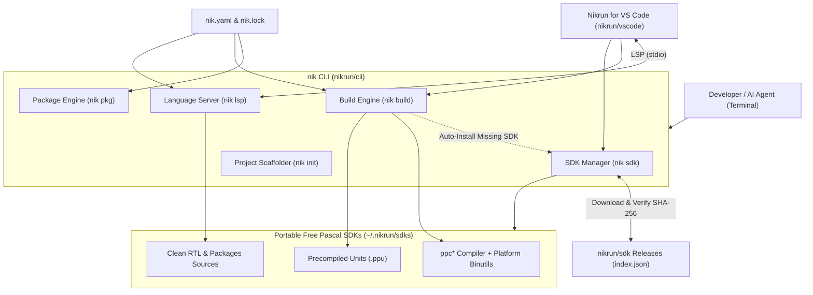

<p align="left">
  <picture>
    <source media="(prefers-color-scheme: dark)" srcset="https://nikrun.dev/brand/nikrun-lockup-dark-mono.svg">
    
  </picture>
</p>

# Nikrun CLI

[](https://github.com/nikrun/cli/actions/workflows/build.yml)
[](https://github.com/nikrun/sdk/actions/workflows/build-fpc-sdk.yml)
[](./LICENSE)
[](https://nikrun.dev)

> **Zero-config toolchain, SDK manager, `nik.yaml` build system, package manager, and Language Server (`nik`) for Free Pascal.**

[nikrun.dev](https://nikrun.dev) · **[`nik` CLI](https://github.com/nikrun/cli)** · [Free Pascal SDKs](https://github.com/nikrun/sdk) · [VS Code Extension](https://github.com/nikrun/vscode) · [Website & Docs](https://github.com/nikrun/web) · [Brand Assets](https://github.com/nikrun/brand) · [Build Library](https://github.com/nikrun/build-lib)

---

**Nikrun** *(named in tribute to [Niklaus Wirth](https://en.wikipedia.org/wiki/Niklaus_Wirth))* brings the cohesive workflow of modern ecosystems like Rust (`rustup` + `cargo`) and Go to **Free Pascal & Object Pascal**. At its core sits the standalone **`nik` CLI** — a single native binary with zero external runtime dependencies that unites portable compiler SDKs, declarative `nik.yaml` builds, decentralized `nik.lock` packages, and a built-in Language Server strictly in user scope (`~/.nikrun`).

This repository contains the **`nik` CLI** (`src/nik.*.pas`) and the standalone, zero-dependency **[`nikrun-lsp-protocol`](./lsp-protocol/README.md)** library (`lsp-protocol/`).

---

## Why Nikrun?

- **Zero System Pollution:** Everything lives cleanly in user scope (`~/.nikrun`) — no administrator/root privileges, no global `PATH` conflicts, and no broken system-wide `/etc/fpc.cfg` files.
- **Instant Multi-Version & Multi-Arch SDKs:** Switch in seconds between Free Pascal `3.2.2`, `3.2.4`, `fixes_3_2`, and nightly `3.3.1` natively across Windows, Linux, and macOS (`x86_64` & `aarch64`) without compiling the compiler yourself.
- **Declarative Projects & Packages (`nik.yaml`):** One clean manifest replaces brittle build scripts, flag chains, and opaque XML project files — complete with profiles, OS/CPU overlays, and SHA-256 lockfile-pinned packages (`nik.lock`).
- **One Binary, Zero Bloat:** SDK management (`nik sdk`), scaffolding (`nik init`), package resolution (`nik pkg`), hermetic direct-`ppc*` compilation (`nik build`), and the built-in Language Server (`nik lsp`) ship inside one native Object Pascal binary.
- **Built for CI/CD & AI Agents:** Deterministic `--json` output, isolated worktree-safe build caches (`.nik/cache/`), and automatic TTY/`NO_COLOR`/`CI` detection make automation effortless.

### How Nikrun Compares

| Aspect | Official freepascal.org Installers | fpcupdeluxe | Nikrun |
| :--- | :--- | :--- | :--- |
| **Setup & System Impact** | Global OS installers (admin/root required, global `/etc/fpc.cfg` & `PATH`) | GUI/CLI builder that compiles FPC & Lazarus locally from source | **100% user scope (`~/.nikrun`)**, zero admin rights, prebuilt portable SDKs |
| **Versions & Nightly Trunk** | Infrequent static releases; parallel installs easily collide | Supports branches/trunk, but requires long local builds & host tools | **`3.2.2`, `3.2.4`, `fixes_3_2` & nightly `3.3.1` side by side in seconds** |
| **Modern OS & ARM64** | No native Windows ARM64 download; sysroot hurdles on modern macOS | Relies on local source patches & bootstrap binaries | **Works out of the box on Win, Linux & macOS (`x86_64` & `aarch64`, incl. Win ARM64)** |
| **Project, IDE & Automation** | Compiler distribution only (sources often separate; no manifest or LSP) | Focused on toolchain building & Lazarus IDE | **End-to-end:** bundled RTL sources, `nik.yaml`, `nik pkg`, `nik build`, `nik lsp`, VS Code & `--json` |

---

## Ecosystem Architecture



---

## Quick Start

```bash
# Discover & manage Free Pascal SDKs (published by nikrun/sdk)
nik sdk list                     # List locally installed SDKs
nik sdk list --remote            # Browse available prebuilt SDKs across versions & architectures
nik sdk install 3.2.4            # Download, SHA-256 verify, and configure Free Pascal 3.2.4
nik sdk install 3.3.1            # Install Free Pascal 3.3.1 alongside 3.2.4
nik sdk update                   # Update installed SDKs to the newest prebuilt commits
nik sdk info 3.3.1               # Inspect SDK health and verified toolchain paths (--json supported)
nik sdk uninstall 3.3.1          # Remove an installed SDK

# Scaffold and build Object Pascal projects
nik init my-app                  # Scaffold a program project (applies ~/.nikrun/template.yaml if present)
nik init my-lib --lib            # Scaffold a shared library (.dll / .so / .dylib)
nik init my-units --pkg          # Scaffold a source-first Object Pascal package
nik build                        # Compile using nik.yaml (auto-installs missing SDK & hydrates dependencies)
nik build -p release             # Optimized release build (--profile release)
nik build --locked --offline     # Hermetic CI/offline build using only local SDKs, nik.lock & cached packages
nik build --clean --json         # Clean checkout cache and emit structured JSON diagnostics

# Inspect, fetch & update decentralized URL/path dependencies (declared in nik.yaml)
nik pkg info https://github.com/nikrun/cli  # Inspect SemVer tags & HEAD commit of any Git URL
nik pkg fetch                    # Pre-fetch all nik.yaml dependencies into ~/.nikrun/cache/pkg/ & sync nik.lock
nik pkg update                   # Upgrade locked SemVer versions in nik.lock within nik.yaml constraints
nik pkg list --json              # Inspect resolved direct & transitive dependency graph
```

### Declarative Project Manifest (`nik.yaml`)

```yaml
schemaVersion: 1

program:
  name: my-app
  version: 0.1.0
  entry: src/main.pas
  output: bin/my-app

  toolchain:
    fpc: 3.2.4              # Exact Free Pascal SDK version ("3.2.2", "3.2.4", "3.3.1")

  build:
    mode: objfpc
    longStrings: true
    cOperators: true
    modeSwitches: [advancedRecords, typeHelpers]
    unitPaths: [src]

  profiles:
    debug:
      build:
        defines: [DEBUG]
        debugInfo: dwarf3
        checks: [range, overflow, io]
    release:
      build:
        defines: ["$reset", RELEASE]
        optimization: 3
        smartLink: true
        stripSymbols: true
    trunk:
      toolchain:
        fpc: "3.3.1"
```

---

## Repository Structure

```text
cli/
├── .github/
│   ├── actions/build/           # Composite GitHub Action for SDK prep, build, test & packaging
│   └── workflows/
│       ├── build.yml            # Multi-OS / Multi-Arch CI build & integration test matrix
│       └── release.yml          # Stable & Insider release workflow + auto version bump PRs
├── brand/                       # Shared Nikrun brand & icon assets (Git submodule)
├── build-lib/                   # Shared Nikrun build & release library (Git submodule)
├── lsp-protocol/                # Standalone, zero-dependency LSP 3.17 & JSON-RPC 2.0 library
│   ├── src/nikrun.lsp.*.pas
│   ├── tests/lsp_protocol_tests.pas
│   └── test.ps1
├── src/
│   ├── nik.pas                  # CLI entry point & global argument dispatcher
│   ├── nik.types.pas            # Domain records, constants & ENikError exception type
│   ├── nik.term.pas             # Cross-platform ANSI styling, tables & progress output
│   ├── nik.platform.pas         # Host OS/CPU architecture detection & startup hardening
│   ├── nik.paths.pas            # ~/.nikrun directory layout & path manipulation helpers
│   ├── nik.fs.pas               # Filesystem directory operations & UTF-8 file I/O
│   ├── nik.sha256.pas           # Pure Object Pascal streaming SHA-256 (RFC 6234)
│   ├── nik.http.pas             # HTTPS/HTTP & file:// client (WinInet on Windows, curl/wget on Unix)
│   ├── nik.archive.pas          # .zip / .tar.gz / .tgz extraction & single-root unwrapping
│   ├── nik.sdk.config.pas       # sdk-manifest.json, index.json & isolated fpc.cfg generator
│   ├── nik.sdk.manager.pas      # SDK discovery, version resolution, download, verification & lifecycle
│   ├── nik.cmd.sdk.pas          # `nik sdk` subcommand CLI parser & formatters
│   ├── nik.pkg.types.pas        # Canonical package IDs, URL/path disambiguation & lockfile records
│   ├── nik.pkg.semver.pas       # SemVer 2.0 parser, constraint evaluator & MVS selector
│   ├── nik.pkg.lock.pas         # Deterministic nik.lock YAML I/O & directory-tree SHA-256 hashing
│   ├── nik.pkg.fetch.pas        # Git Smart HTTP / git CLI discovery & immutable ~/.nikrun/cache/pkg/ fetcher
│   ├── nik.pkg.resolve.pas      # Transitive MVS package graph resolver & local URL override engine
│   ├── nik.cmd.pkg.pas          # `nik pkg` subcommand CLI parser (`fetch`, `update`, `list`, `info`)
│   ├── nik.cmd.init.pas         # `nik init` project scaffolder & ~/.nikrun/template.yaml loader
│   ├── nik.yaml.pas             # Pure Object Pascal YAML subset parser with line tracking
│   ├── nik.manifest.types.pas   # nik.yaml domain records, overlay records & TResolvedManifest
│   ├── nik.manifest.io.pas      # nik.yaml discovery, YAML deserialization & strict schema validation
│   ├── nik.manifest.resolve.pas # In-memory targets, test & profiles overlay resolver
│   ├── nik.compiler.diag.pas    # Free Pascal (ppc*) diagnostic parser (file, line, col, code, severity)
│   ├── nik.compiler.types.pas   # Manifest-agnostic compiler contract (TCompileSpec & TCompileResult)
│   ├── nik.compiler.pas         # Hermetic ppc* flag builder & compiler process runner
│   ├── nik.project.pas          # Project target bridge (nik.manifest.* + nik.sdk.* -> TCompileSpec)
│   ├── nik.cmd.build.pas        # `nik build` CLI parser & human/JSON output formatters
│   ├── nik.lsp.index.pas        # Lazarus CodeTools-backed Object Pascal AST, symbol & doc indexer
│   ├── nik.lsp.check.pas        # Non-blocking ppc* -Cn workspace & unsaved-overlay check runner
│   ├── nik.lsp.server.pas       # TNikPascalLspServer binding nikrun.lsp.server to Nikrun SDKs
│   └── nik.cmd.lsp.pas          # `nik lsp` CLI parser (--stdio, --socket, --profile, --log-file)
├── vendor/
│   └── lazarus/                 # Shallow Lazarus submodule providing CodeTools & LazUtils
├── version.txt                  # Single source of truth SemVer (e.g. 0.1.0)
├── changelog.yml                # Structured Keep-a-Changelog release history
├── prepare.ps1                  # Provisions & verifies newest prebuilt Nikrun FPC SDK from nikrun/sdk
├── build.ps1                    # Compiles, tests & packages nik-<versionTag>-<triplet>.zip + manifest.json
└── test.ps1                     # End-to-end integration test suite + nikrun-lsp-protocol unit tests
```

---

## Development & Testing

```powershell
# 1. Initialize submodules & provision newest prebuilt Nikrun Free Pascal SDK into ~/.nikrun (first-time setup)
git submodule update --init --recursive --depth 1
.\prepare.ps1

# 2. Full build, test & package pipeline (outputs ZIP, release-notes.json & manifest.json to .out/)
.\build.ps1

# 3. Fast local compile without running test suites -> bin/nik(.exe)
.\build.ps1 -Profile debug -RunTests:$false

# 4. Build optimized release binary and install into ~/.nikrun/bin
.\build.ps1 -Profile release -Install -RunTests:$false

# 5. Run full end-to-end CLI & LSP test suite standalone
.\test.ps1
```

### Environment Variables

| Variable | Description |
| :--- | :--- |
| `NIKRUN_HOME` | Overrides the default `~/.nikrun` root directory (can also be passed via `--nikrun-home <dir>`). |
| `NIKRUN_SDK_INDEX_URL` | Overrides the remote `index.json` URL or local file path (can also be passed via `--index-url <url>`). |
| `NO_COLOR` | Disables ANSI colors when set to a non-empty value (can also be passed via `--no-color`). |

---

## License

Copyright (c) 2026 The Nikrun Contributors.

Licensed under the **GNU General Public License v3.0 or later** (`GPL-3.0-or-later`) — see [LICENSE](./LICENSE).

> **Note on Projects Built with Nikrun:** Using `nik` or **Nikrun for VS Code** to initialize (`nik init`), analyze (`nik lsp`), or compile (`nik build`) your own Free Pascal & Object Pascal applications, libraries, or packages imposes **no** licensing restrictions on your source code or compiled binaries. You remain free to license and distribute your own projects under any open-source or commercial/proprietary terms.
