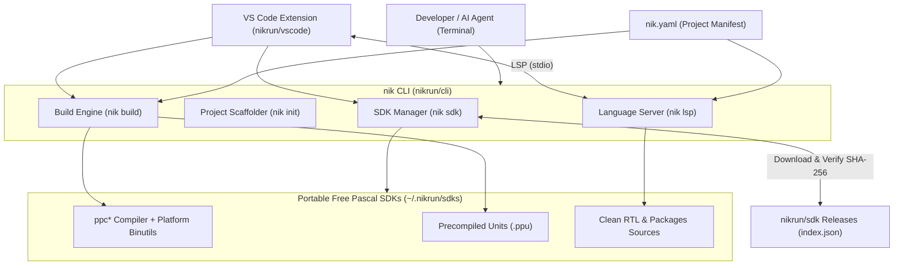

# Nikrun — `nik` CLI (`nikrun/cli`)

[](https://github.com/nikrun/cli/actions/workflows/build.yml)
[](https://github.com/nikrun/sdk/actions/workflows/build-fpc-sdk.yml)

> **Modern, Zero-Config Toolchain & Developer Experience for Free Pascal**  
> *(Named in tribute to [Niklaus Wirth](https://en.wikipedia.org/wiki/Niklaus_Wirth))*

**Nikrun** is an integrated developer ecosystem designed to bring a modern, cohesive workflow—familiar from ecosystems like Rust (`rustup` + `cargo`), Go, or the .NET CLI—to **Object Pascal / Free Pascal**.

This repository contains the standalone **`nik` CLI** (`src/nik.*.pas`) and the zero-dependency **`nikrun-lsp-protocol`** library (`lsp-protocol/`).

### Nikrun Ecosystem Repositories

- **[`nikrun/cli`](https://github.com/nikrun/cli)** *(this repository)* — Standalone `nik` CLI (`nik sdk`, `nik init`, `nik build`, `nik lsp`) and `nikrun-lsp-protocol`
- **[`nikrun/sdk`](https://github.com/nikrun/sdk)** — Automated build pipeline and GitHub Releases (`latest`) for portable Free Pascal SDK archives (`3.2.2`, `3.2.4`, `3.2.5`, `3.3.1`)
- **[`nikrun/vscode`](https://github.com/nikrun/vscode)** — Official `vscode-nikrun` Visual Studio Code extension for Object Pascal / Free Pascal

---

## Why Nikrun?

- **Zero System Pollution:** Everything lives cleanly in user scope (`~/.nikrun`)—no administrator/root privileges, no global `PATH` conflicts, and no broken system-wide `fpc.cfg` files.
- **Instant Multi-Version & Multi-Arch SDKs:** Switch seamlessly between Free Pascal versions (`3.2.2`, `3.2.4`, `3.3.1`) and CPU/OS targets (`win64`, `linux`, `darwin` on `x86_64` and `aarch64`) without compiling the compiler yourself.
- **Declarative Projects (`nik.yaml`):** Define compiler requirements, build targets, profiles, and dependencies in one clean manifest instead of maintaining fragile shell scripts or manual unit search paths.
- **Batteries-Included Tooling:** SDK management, scaffolding (`nik init`), hermetic compilation (`nik build`), and Language Server (`nik lsp`) all live inside a single native `nik` CLI binary with zero external runtime dependencies.
- **Agent & CI Ready Out of the Box:** Deterministic `--json` output, checkout-local build caches (`.nik/cache/`), and automatic TTY/`NO_COLOR`/`CI` handling.

### How Nikrun Compares

| Aspect | Official `freepascal.org` Downloads | `fpcupdeluxe` | Nikrun |
| :--- | :--- | :--- | :--- |
| **Setup & Isolation** | Global OS installers (`.exe` wizard, root `.pkg`, interactive `install.sh` + `/etc/fpc.cfg`) | GUI/CLI builder that compiles FPC & Lazarus from source on your machine | **Zero-config, user-scope `nik` CLI + prebuilt portable `.zip` SDKs** (`~/.nikrun`) |
| **Versions & Nightly Trunk** | Rare static releases (`3.2.2` is from 2021); parallel installs collide in global `PATH` / `fpc.cfg` | Supports branches/trunk, but requires long local source builds and host build tools | **Instant side-by-side installs** of `3.2.2`, `3.2.4`, `fixes_3_2`, and nightly `3.3.1` in seconds |
| **Modern OS & CPU Support** | No native `aarch64-win64` download; `3.2.2` often fails out-of-the-box on modern macOS/Xcode sysroots | Relies on local source patches and third-party bootstrap binaries | **Works out of the box** on Win/Linux/macOS (`x86_64` & `aarch64`, incl. native Windows ARM64) via isolated `fpc.cfg` |
| **Sources, Tooling & CI** | Compiler distribution only (sources often separate; no manifest, package manager, or CI automation) | Toolchain & Lazarus IDE installer | **Unified workflow:** bundled `rtl`/`packages` sources, `nik.yaml`, `nik init`/`build`, `nik lsp`, `--json` & CI ready |

---

## Ecosystem Architecture



---

## Quick Start & Usage

```bash
# Discover & manage Free Pascal SDKs (published by nikrun/sdk)
nik sdk list                     # List locally installed SDKs
nik sdk list --remote            # Browse available prebuilt SDKs across versions & architectures
nik sdk install 3.2.4            # Download, SHA-256 verify, and configure FPC 3.2.4
nik sdk install 3.3.1            # Install FPC 3.3.1 alongside 3.2.4
nik sdk info 3.3.1               # Inspect SDK health and verified toolchain paths (--json supported)
nik sdk uninstall 3.3.1          # Remove an installed SDK

# Scaffold and build Object Pascal projects
nik init my-app                  # Scaffold a program project (applies ~/.nikrun/template.yaml if present)
nik init my-lib --lib            # Scaffold a shared library (.dll / .so / .dylib)
nik init my-units --pkg          # Scaffold a source-first Object Pascal package
nik build                        # Compile using the exact toolchain.fpc and flags in nik.yaml
nik build -p release             # Optimized release build (--profile release)
nik build --clean --json         # Clean checkout cache and emit structured JSON diagnostics
```

### Declarative Project Manifest (`nik.yaml`)

```yaml
schemaVersion: 1

program:
  name: my-app
  version: 0.1.0
  entry: src/main.pas
  output: bin/my-app

  toolchain:
    fpc: 3.2.4              # Exact Free Pascal SDK version ("3.2.2", "3.2.4", "3.3.1")

  build:
    mode: objfpc
    longStrings: true
    cOperators: true
    modeSwitches: [advancedRecords, typeHelpers]
    unitPaths: [src]

  profiles:
    debug:
      build:
        defines: [DEBUG]
        debugInfo: dwarf3
        checks: [range, overflow, io]
    release:
      build:
        defines: ["$reset", RELEASE]
        optimization: 3
        smartLink: true
        stripSymbols: true
    trunk:
      toolchain:
        fpc: "3.3.1"
```

---

## Repository Structure

```text
cli/
├── .github/
│   ├── actions/build/           # Composite GitHub Action for SDK prep, build, test & packaging
│   └── workflows/
│       ├── build.yml            # Multi-OS / Multi-Arch CI build & integration test matrix
│       └── release.yml          # Stable & Insider release workflow + auto version bump PRs
├── build-lib/                   # Shared Nikrun build & release library (Git submodule)
├── lsp-protocol/                # Standalone, zero-dependency LSP 3.17 & JSON-RPC 2.0 library
│   ├── src/nikrun.lsp.*.pas
│   ├── tests/lsp_protocol_tests.pas
│   └── test.ps1
├── src/
│   ├── nik.pas                  # CLI entry point & global argument dispatcher
│   ├── nik.types.pas            # Domain records, constants & ENikError exception type
│   ├── nik.term.pas             # Cross-platform ANSI styling, tables & progress output
│   ├── nik.platform.pas         # Host OS/CPU architecture detection & startup hardening
│   ├── nik.paths.pas            # ~/.nikrun directory layout & path manipulation helpers
│   ├── nik.fs.pas               # Filesystem directory operations & UTF-8 file I/O
│   ├── nik.sha256.pas           # Pure Object Pascal streaming SHA-256 (RFC 6234)
│   ├── nik.http.pas             # HTTPS/HTTP & file:// client (WinInet on Windows, curl/wget on Unix)
│   ├── nik.archive.pas          # ZIP extraction & Unix executable permission handling
│   ├── nik.sdk.config.pas       # sdk-manifest.json, index.json & isolated fpc.cfg generator
│   ├── nik.sdk.manager.pas      # SDK discovery, version resolution, download, verification & lifecycle
│   ├── nik.cmd.sdk.pas          # `nik sdk` subcommand CLI parser & formatters
│   ├── nik.cmd.init.pas         # `nik init` project scaffolder & ~/.nikrun/template.yaml loader
│   ├── nik.yaml.pas             # Pure Object Pascal YAML subset parser with line tracking
│   ├── nik.manifest.types.pas   # nik.yaml domain records, overlay records & TResolvedManifest
│   ├── nik.manifest.io.pas      # nik.yaml discovery, YAML deserialization & strict schema validation
│   ├── nik.manifest.resolve.pas # In-memory targets, test & profiles overlay resolver
│   ├── nik.compiler.diag.pas    # Free Pascal (ppc*) diagnostic parser (file, line, col, code, severity)
│   ├── nik.compiler.types.pas   # Manifest-agnostic compiler contract (TCompileSpec & TCompileResult)
│   ├── nik.compiler.pas         # Hermetic ppc* flag builder & compiler process runner
│   ├── nik.project.pas          # Project target bridge (nik.manifest.* + nik.sdk.* -> TCompileSpec)
│   ├── nik.cmd.build.pas        # `nik build` CLI parser & human/JSON output formatters
│   ├── nik.lsp.index.pas        # Lazarus CodeTools-backed Object Pascal AST, symbol & doc indexer
│   ├── nik.lsp.check.pas        # Non-blocking ppc* -Cn workspace & unsaved-overlay check runner
│   ├── nik.lsp.server.pas       # TNikPascalLspServer binding nikrun.lsp.server to Nikrun SDKs
│   └── nik.cmd.lsp.pas          # `nik lsp` CLI parser (--stdio, --socket, --profile, --log-file)
├── vendor/
│   └── lazarus/                 # Shallow Lazarus submodule providing CodeTools & LazUtils
├── version.txt                  # Single source of truth SemVer (e.g. 0.1.0)
├── changelog.yml                # Structured Keep-a-Changelog release history
├── prepare.ps1                  # Provisions & verifies newest prebuilt Nikrun FPC SDK from nikrun/sdk
├── build.ps1                    # Compiles, tests & packages nik-<versionTag>-<triplet>.zip + manifest.json
└── test.ps1                     # End-to-end integration test suite + nikrun-lsp-protocol unit tests
```

---

## Building & Testing Locally

```powershell
# 1. Initialize submodules & provision newest prebuilt Nikrun FPC SDK into ~/.nikrun (first-time setup)
git submodule update --init --recursive --depth 1
.\prepare.ps1

# 2. Full build, test & package pipeline (outputs ZIP, release-notes.json & manifest.json to .out/)
.\build.ps1

# 3. Fast local compile without running test suites -> bin/nik(.exe)
.\build.ps1 -Profile debug -RunTests:$false

# 4. Build optimized release binary and install into ~/.nikrun/bin
.\build.ps1 -Profile release -Install -RunTests:$false

# 5. Run full end-to-end CLI & LSP test suite standalone
.\test.ps1
```

### Environment Variables

| Variable | Description |
| :--- | :--- |
| `NIKRUN_HOME` | Overrides the default `~/.nikrun` root directory (can also be passed via `--nikrun-home <dir>`). |
| `NIKRUN_SDK_INDEX_URL` | Overrides the remote `index.json` URL or local file path (can also be passed via `--index-url <url>`). |
| `NO_COLOR` | Disables ANSI colors when set to a non-empty value (can also be passed via `--no-color`). |

---

## License

Copyright (c) 2026 The Nikrun Contributors.

Licensed under the **GNU General Public License v3.0 or later** (`GPL-3.0-or-later`) — see [LICENSE](./LICENSE).

> **Note on Projects Built with `nik`:** Using `nik` to initialize (`nik init`), analyze (`nik lsp`), or compile (`nik build`) your own Object Pascal applications, libraries, or packages imposes **no** licensing restrictions on your source code or compiled binaries. You remain free to license and distribute your own projects under any open-source or commercial/proprietary terms.
